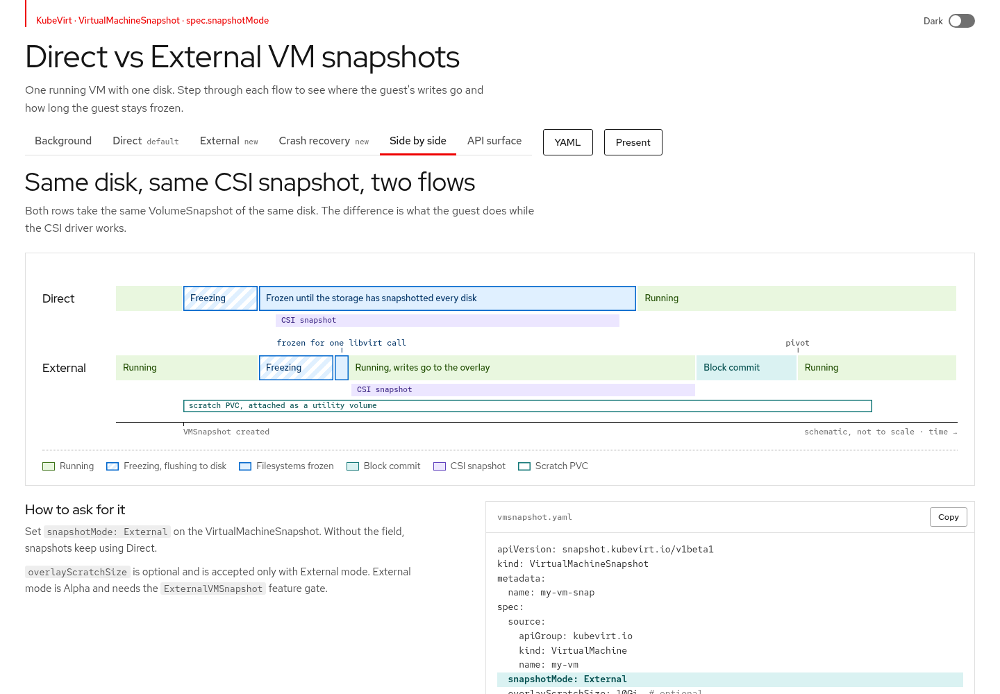
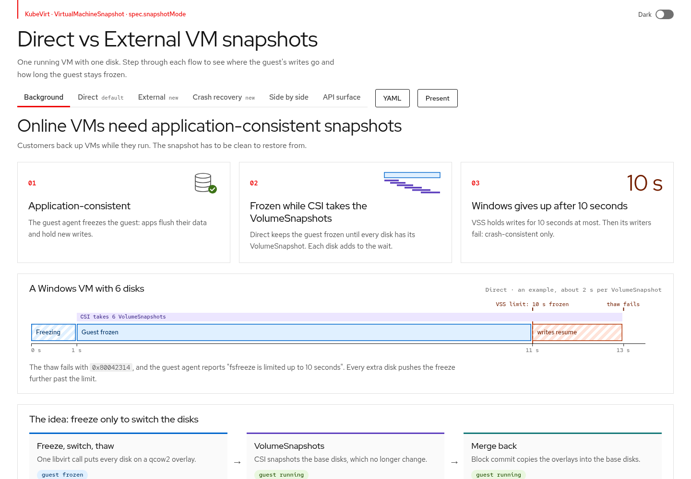

# i-need-to-see-it

**"I don't get it until I see it."** A skill for coding agents that turns code into
something you can look at and step through. Giving eyes to developers.


## What it does

Type `i-need-to-see-it` and then anything: a few words ("pvc attachment to a pod"),
one or more YAML manifests, a branch or PR, a design proposal, a ticket link, a pasted
log, or nothing but the conversation so far. The agent reads the real code at a pinned
ref, works out which components talk to each other, and builds one interactive page
that shows three things at once:

1. **What talks to what.** A scene of the real components where they really live,
   with control arrows (who asks whom) and data arrows (where the bytes actually go).
2. **What happens over time.** Flows you step through. Each step changes the scene: a
   component lights up, an arrow switches, a state badge changes, an object appears.
   A rail and timeline lanes show every step at once, so you always know where you
   are.
3. **Everything around it.** For each step: what happens and why, a note with the
   numbers and limits, code links at the pinned commit, the facts that track the
   state. Then a side-by-side view: both flows on one timeline, the one sentence to
   remember, a table of differences, how to ask for it.

In `--detailed` mode the page also carries the full API surface, object by object,
a folded "In the API" line under every step saying exactly what changed, and a YAML
drawer (key Y) that shows each object's fields as they change from step to step,
or each object whole, in its own data serialization or interchange format.

Every arrow, name and number on the page comes from the code at that ref. The agent
never invents a line number, a name or a motive, and it treats GitHub, Jira and every
other external system as read-only.

When you want words instead of a page, ask for them. "Just explain it" gets a
cause-and-effect explanation in chat, short version first. "Write this up" gets a
saved Markdown story with a guided code walkthrough. Same code, same pinned ref.

The same page serves two moments: understanding something alone at your desk, and
presenting it to the team. It opens as a private Artifact when the agent's host has
one, and it is always written as a standalone HTML file you can open from disk,
present from with a clicker, or send around.

## Install

Claude Code, as a plugin:

```
/plugin marketplace add noamasu/i-need-to-see-it
/plugin install i-need-to-see-it@i-need-to-see-it
```

By hand, for Claude Code or any agent that reads `SKILL.md` folders (Codex, Cursor
and others):

```bash
git clone https://github.com/noamasu/i-need-to-see-it
cp -r i-need-to-see-it/skills/* ~/.claude/skills/      # or your agent's skills folder
```

Requirements: `git`; Google Chrome or Chromium for the screenshot check the skill runs
on its own pages (`CHROME=/path/to/chrome` when it is not on the PATH); `node` for the
detailed-mode anchor check; `gh` when the code or the PR lives on GitHub.

## Use it

```
/i-need-to-see-it pvc attachment to a pod in k8s
/i-need-to-see-it <paste a pod and a pvc yaml> --detailed
/i-need-to-see-it the bug in TICKET-123 and its fix --for qe
/i-need-to-see-it this --presentation --plain
/i-need-to-see-it external snapshots --style redhat
/i-need-to-see-it the login flow --repo ~/src/auth-service --ref v2.3.0
/i-need-to-see-it the retry path --style ~/brand/our-template.pdf

/i-need-to-see-it just explain how hotplug works
/i-need-to-see-it write up this fix so the team can read it later
```

| Flag | Effect |
|---|---|
| `--detailed` | adds the API surface view, the folded "In the API" block under every step, and the YAML drawer (key Y) with the objects at each step and what changes in them |
| `--plain` | steps only: no API surface, no "In the API" block, no drawer |
| `--style <name or file>` | the look: `plain` (default), `redhat`, a saved style, or a PDF, PPTX, HTML, CSS or image to learn a style from |
| `--repo <path or URL>` | where the code is, when it is not the current repo |
| `--ref <sha, tag or branch>` | the ref to read at |
| `--for qe` / `--for dev` | the audience; QE pages say what to observe and assert at each step |
| `--learning` / `--presentation` | learning opens on a Background tab and keeps the full notes; presentation drops it and trims every step to what fits a projector |

Before reading code, the skill asks once, in one message, about the choices the ask
did not settle: the mode, the audience, the level of detail, and on the very first run
where to keep the files. None of the three has a default. Answer, or say "you choose"
and the agent picks and tells you what it picked.



## Where the files go

On first use the skill asks for a folder and suggests `~/explainers`. The choice is
saved in `~/.config/i-need-to-see-it/pool` (`$EXPLAINER_POOL` overrides it), and
everything the skill writes goes there:

```
~/explainers/
├── README.md                     # the index, newest first
├── visual/2026-11-07-pvc-attach.html
└── stories/2026-11-07-pvc-attach.md
```

Each page is a self-contained HTML file. Open it from disk, step through it with the
arrow keys or a presenter clicker, press F for full screen and D for dark mode, copy
the URL with its `#flow/step` hash to link to one step.

## Styles

A style is the fonts, the surfaces and the colors, kept apart from the engine, so a
page reads the same way whichever style it wears. `plain` is the default. `redhat` is
Red Hat's expressive slide template without the logo, distilled into tokens. Bring
your own file with `--style path/to/template.pdf`: the agent reads it, writes a style
file with the fonts, the tokens and what each color may mean, applies it and saves it
under a name you can reuse. Pages open light. Every style also carries a dark set
behind the Dark switch at the top right; it is off by default and never follows the
system theme, so a page looks the same on every projector. A brand's emphasis color
is never used to mean "bad". See `skills/i-need-to-see-it/references/styles/README.md`.



## The bar

Two pages set the standard the skill holds itself to, both about the same KubeVirt
feature, external VM snapshots:
`skills/i-need-to-see-it/references/snapshot-flows.html` and
`skills/i-need-to-see-it/references/snapshot-flows-detailed.html`. They are page
fragments as the Artifact host serves them; to open one from disk, wrap it first:

```bash
skills/i-need-to-see-it/scripts/standalone.sh skills/i-need-to-see-it/references/snapshot-flows.html /tmp/snapshot-flows.html
```

## How a page gets built

`skills/i-need-to-see-it/SKILL.md` is the whole procedure: read the ask, pick the
story shape, find the code and pin a ref, walk one concrete example through it, cast
the boxes and script the steps, build from `assets/template.html`, render it and look
at it, deliver. The references behind it:

- `references/casting.md`: from any input to boxes, flows and steps; where to look in
  the code; the idioms ("the code does X, draw Y"); casts for Kubernetes core, CSI
  and KubeVirt, and for services and races.
- `references/anatomy.md`: the page engine, the scene vocabulary and what each piece
  can stand for, the tones, the traps.
- `references/detailed.md`: what to collect for the API surface, how to write the
  per-step lines and the YAML drawer.
- `references/modes.md`: the learning and presentation modes.
- `references/explaining.md` and `references/story.md`: the two outputs in words, an
  explanation in chat and a saved write-up, and the method behind the page's own
  prose.
- `references/styles/`: the styles and how to learn one from a file.
- `scripts/`: `shoot.sh` renders a step to PNG (`DARK=1` for the dark set),
  `standalone.sh` writes the file that opens from disk, `versions.sh` answers "which
  releases does this apply to", `pool.sh` keeps the folder choice.

The engine was built in the Kubernetes and KubeVirt world, where controllers, node
agents and storage make the clearest boxes. The scene's pieces are roles, so a page
about a web service, a queue or a scheduler reuses them with other names.

## Privacy

Pages are built from code the agent can read and from what you give it. They carry
code links, object names and numbers from that code, so look at a page before sharing
it outside the people who may see the code. Artifacts are private until you share
them. Nothing is ever written to GitHub, Jira or any other external system.

## License

AGPL-3.0, see `LICENSE`.
